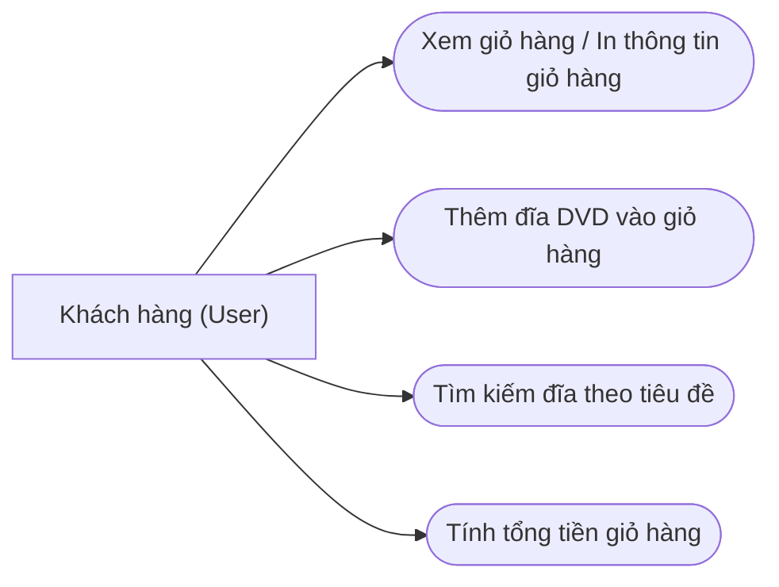

# Biểu đồ và Đặc tả Ca sử dụng (Use Case) - AIMS-mini

## 1. Biểu đồ Ca sử dụng (Use Case Diagram)

## 2. Danh sách và Đặc tả Ca sử dụng chính

### UC1: Thêm đĩa DVD vào giỏ hàng (Add DVD)
- **Tác nhân:** Khách hàng.
- **Mô tả:** Cho phép khách hàng thêm đĩa DVD với thông tin tiêu đề, thể loại, đạo diễn, thời lượng và giá tiền vào giỏ hàng.
- **Ràng buộc:** Giỏ hàng chỉ chứa tối đa 20 đĩa DVD (`MAX_NUMBERS_ORDERED = 20`).

### UC2: In thông tin giỏ hàng (Print Cart)
- **Tác nhân:** Khách hàng.
- **Mô tả:** Hiển thị danh sách các DVD hiện có trong giỏ hàng, chi tiết từng đĩa theo định dạng chuẩn và tổng số tiền thanh toán. Nếu giỏ hàng trống, in thông báo `The cart is empty`.

### UC3: Tìm kiếm đĩa theo tiêu đề (Search by Title)
- **Tác nhân:** Khách hàng.
- **Mô tả:** Cho phép tìm kiếm các đĩa DVD trong danh sách có tiêu đề chứa từ khóa tìm kiếm.
